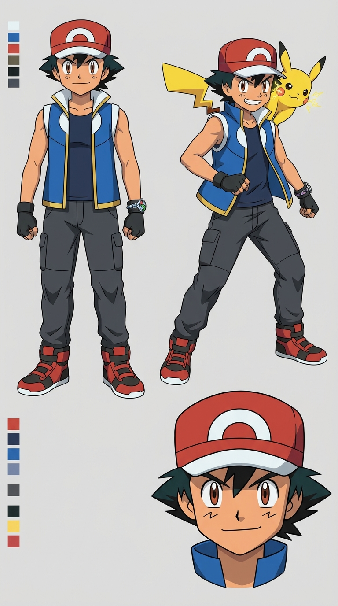
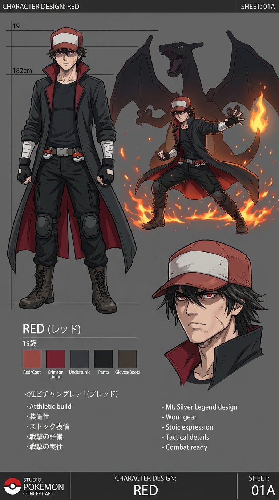
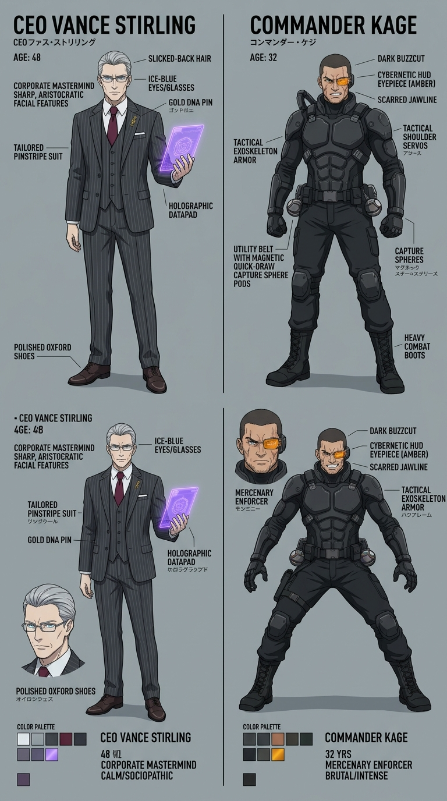

# 🎨 PROJECT ORIGIN: THE SHATTERED CROWN
## Master Production Character Sheets & Visual Model Specifications

This document defines the definitive anatomical, aesthetic, wardrobe, colorimetric, and behavioral standards for the lead characters of *Project Origin: The Shattered Crown*. These specifications serve as the single source of truth for all storyboard artists, AI keyframe synthesis models, and 3D/2D animation compositors across all 60 episodes.

---

## 📏 1. Height Comparison & Anatomical Proportions

```
[Pikachu]  [Ash Ketchum]   [Brock]     [Red]     [Stirling]   [Kage]     [Charizard]
  0.4m        1.68m         1.78m      1.82m       1.85m       1.93m        2.20m
   │           │             │          │           │           │            │
  40cm       168cm         178cm      182cm       185cm       193cm        220cm
 (1'4")      (5'6")        (5'10")    (6'0")      (6'1")      (6'4")       (7'3")
```

- **Ash Ketchum (168 cm / 5'6"):** Athletic, agile, lightweight teenage build ($58\text{ kg}$). Fast, buoyant center of gravity. Long legs relative to torso for high-speed sprinting and acrobatic leaps.
- **Red (182 cm / 6'0"):** Broad-shouldered, lean, hardened muscular build ($76\text{ kg}$). Low, grounded center of gravity. Moves with disciplined, silent, predator-like economy of motion.
- **Vance Stirling (185 cm / 6'1"):** Aristocratic, upright posture. Zero slouching, hands often clasped behind back or holding a datapad.
- **Commander Kage (193 cm / 6'4"):** Heavyweight, cybernetically augmented build ($108\text{ kg}$). Broad chest with hydraulic armor bulk. Imposing forward lean.
- **Red's Charizard (220 cm / 7'3"):** Unusually colossal specimen ($155\text{ kg}$), towering over both human trainers. Massive wingspan ($4.2\text{ meters}$).

---

## 🎨 2. Official Production Color Palette (Hex & RGB)

### Ash Ketchum (The World Monarch Palette)
| Garment / Feature | Hex Code | RGB Values | Visual Description |
| :--- | :--- | :--- | :--- |
| **Vest Body** | `#0F2C59` | `rgb(15, 44, 89)` | Deep royal navy blue fabric |
| **Vest Trim & Accents** | `#F59E0B` | `rgb(245, 158, 11)` | Burnished metallic gold piping |
| **Collar & Inner Vest** | `#F8FAFC` | `rgb(248, 250, 252)` | Crisp high-contrast white |
| **Compression Base** | `#1E293B` | `rgb(30, 41, 59)` | Matte charcoal-black athletic weave |
| **Trainer Cap** | `#DC2626` | `rgb(220, 38, 38)` | Saturated crimson red with white front panel |
| **Z-Ring Keystone** | `#38BDF8` | `rgb(56, 189, 248)` | Luminescent cyan crystal aura |
| **Eyes & Hair** | `#3E2723` / `#09090B` | `rgb(62, 39, 35)` | Warm dark chestnut brown irises; jet black hair |

### Red (The Mt. Silver Legend Palette)
| Garment / Feature | Hex Code | RGB Values | Visual Description |
| :--- | :--- | :--- | :--- |
| **Duster Trenchcoat** | `#18181B` | `rgb(24, 24, 27)` | Weathered charcoal-black canvas |
| **Trenchcoat Silk Lining** | `#991B1B` | `rgb(153, 27, 27)` | Deep blood-crimson interior lining |
| **Trainer Cap** | `#991B1B` / `#D4D4D8` | `rgb(153, 27, 27)` | Worn, sun-faded red bill with scuffed white crown |
| **Crimson Eyes** | `#EF4444` | `rgb(239, 68, 68)` | Piercing crimson-tinted irises (Mt. Silver reflection) |
| **Combat Hand Wraps** | `#E2E8F0` | `rgb(226, 232, 240)` | Weathered athletic tape over forearms |
| **Pokéball Utility Belt** | `#78350F` | `rgb(120, 53, 15)` | Distressed dark brown saddle leather with matte clips |

### Consortium Tech & Antagonists Palette
| Asset / Feature | Hex Code | RGB Values | Visual Description |
| :--- | :--- | :--- | :--- |
| **Helix Chip Core** | `#9333EA` | `rgb(147, 51, 234)` | Menacing radioactive violet glow |
| **Exoskeleton Armor** | `#090D16` | `rgb(9, 13, 22)` | Non-reflective stealth matte black |
| **Cybernetic Visor (Kage)** | `#F97316` | `rgb(249, 115, 22)` | Sharp amber-orange tactical reticle |
| **Stirling Executive Suit** | `#334155` | `rgb(51, 65, 85)` | Slate pinstripe wool with silver DNA lapel pin |

---

## 👤 3. Detailed Character Sheets

### Character Sheet 1: Ash Ketchum (Age 16)



```
┌────────────────────────────────────────────────────────┐
│ ASH KETCHUM • THE REIGNING WORLD MONARCH               │
│ Age: 16 • Height: 168 cm • Eyes: Brown • Hair: Black   │
└────────────────────────────────────────────────────────┘
```

#### Facial Features & Hair
- **Head & Jaw:** Slightly tapered jawline reflecting physical maturity past age 15, retaining characteristic soft cheek curvature.
- **Cheek Marks:** Prominent double-horizontal zig-zag marks beneath both eyes; marks flush with faint electrical spark arcs when Pikachu is synchronized.
- **Eyes:** Large, expressive almond-shaped dark chestnut-brown eyes. Radiant catch-light showing unyielding optimism. Thick, animated black eyebrows.
- **Hair:** Iconic messy, spiky black hair with 5 distinct frontal tufts protruding beneath the trainer cap brim.

#### Wardrobe Layers (Inside-Out)
1. **Base Layer:** Sleeveless matte charcoal-black compression athletic undershirt. High-tensile moisture-wicking material.
2. **Outer Layer:** Sleeveless royal-blue vest with standing white collar, metallic gold piping along armholes and hem, unbuttoned front showing chest compression layer.
3. **Pants:** Charcoal-gray tapered cargo joggers with reinforced abrasion-resistant knee stitching and zip utility pockets.
4. **Footwear:** High-top red-and-black athletic sneakers with white soles and reinforced shock-absorbing heels.
5. **Accessories:**
   - **Right Wrist:** Alolan Z-Ring with embedded Pikashunium Z crystal.
   - **Left Wrist:** Mega Evolution Keystone leather wristband with polished rainbow Keystone.
   - **Hands:** Black fingerless tactical driving gloves with green Pokéball accents on knuckle straps.
   - **Headwear:** Classic red-and-white trainer cap with modern curved white Pokéball semicircle insignia. Worn straight forward.

#### Expression Matrix (5 Core Emotional States)
1. **Neutral / Curious:** Slight head tilt, soft smile, relaxed shoulders, open inquisitive gaze.
2. **Battle Determination:** Teeth clenched, eyebrows drawn low, pupils dilated, body lowered in a forward-leaning athletic crouch.
3. **Moral Outrage (Vs. Consortium):** Furious wide-eyed glare, trembling fists, aura-blue faint vapor rising from skin.
4. **Protective Instinct:** Body rotated sideways to physically shield Pikachu or wounded Pokémon from ballistic attacks.
5. **Victorious Comradery:** Wide, open-mouthed grin, hand thrown back in exuberant celebration, thumb pointed at chest.

---

### Character Sheet 2: Red (Age 19)



```
┌────────────────────────────────────────────────────────┐
│ RED • THE PHANTOM OF MT. SILVER                        │
│ Age: 19 • Height: 182 cm • Eyes: Crimson • Hair: Black │
└────────────────────────────────────────────────────────┘
```

#### Facial Features & Hair
- **Head & Jaw:** Angular, chiselled jawline with high cheekbones and lean facial planes. A faint $2.5\text{cm}$ vertical scar runs down the left jawline from an ancient wild battle.
- **Eyes:** Hooded, narrow, intense eyes with deep red irises. The upper third of his eyes is almost perpetually shaded by his cap's bill. When he looks up directly, the gaze is paralyzing.
- **Hair:** Dark shaggy jet-black hair falling in uneven, wind-swept locks around his ears and neck.
- **Facial Hair:** Clean-shaven with faint stubble shadow along the jawline reflecting long weeks in the wilderness.

#### Wardrobe Layers (Inside-Out)
1. **Base Layer:** Heavy-knit dark slate-gray thermal long-sleeve combat undershirt with reinforced elbow padding.
2. **Outer Duster:** Floor-length high-collared charcoal-black canvas duster trenchcoat. Deep blood-crimson silk inner lining that flashes during rapid turns or wind gusts. Weathered, rain-proofed, slightly frayed at the lower hem.
3. **Pants:** Tapered black combat cargo trousers tucked into military-grade lace-up leather boots with steel toe-caps.
4. **Accessories:**
   - **Hands:** Worn black fingerless gloves over tight white combat tape wrapped from knuckles to mid-forearm.
   - **Headwear:** Weathered, faded red trainer cap with cracked leather bill. Worn pulled low over forehead.
   - **Belt:** Heavy leather utility belt carrying 6 matte-black custom Pokéballs with reinforced locking clasps.

#### Expression Matrix (5 Core Emotional States)
1. **The Ghost (Standard):** Totally motionless, unblinking crimson eyes, mouth a flat straight line, cap shadow masking upper face.
2. **Tactical Calculation:** Eyes darting rapidly across the battlefield, slight narrowing of eyelids, single subtle finger gesture.
3. **Rare Approval:** Micro-smirk lifting the corner of his mouth by 2 millimeters, accompanied by a single decisive nod.
4. **Primal Rage (Vs. Pokémon Abuse):** Cap pushed back, eyes blazing neon red, aura of raw thermal heat radiating from his presence.
5. **The Quiet Guardian:** Gentle resting of his gloved hand on Charizard's snout, eyes softened in absolute loyalty.

---

### Character Sheet 3: Corporate Antagonists



#### CEO Vance Stirling (Age 48)
- **Anatomy:** $185\text{cm}$, lean aristocrat, aristocratic silver-threaded gray hair combed back with pomade. Thin titanium rectangular spectacles.
- **Wardrobe:** Bespoke three-piece charcoal pinstripe Italian-cut suit, white Egyptian cotton shirt, deep burgundy silk tie, gold double-helix tie bar and lapel pin.
- **Key Prop:** Encrypted violet holographic datapad displaying real-time telemetry and vital statistics of chipped subjects.
- **Demeanor:** Never raises his voice; maintains courtly, boardroom politeness while ordering executions or forced biological extractions.

#### Commander Kage (Age 32)
- **Anatomy:** $193\text{cm}$, massive build, scarred jawline, buzzcut hair, right eye replaced by an amber-glowing tactical HUD visor.
- **Wardrobe:** Matte-black hydraulic exoskeleton combat harness over reinforced tactical Kevlar mesh. Magnetic holster clips for 6 Helix-linked capture spheres.
- **Demeanor:** Aggressive, loud, sneering contempt for standard League trainers and sports rules.

---

## 🤖 4. AI Generation Master Prompts & Negative Constraints

### Master Prompt: Ash Ketchum (World Monarch 9:16 Vertical)
```
cinematic anime character concept, high-end theatrical animation, 9:16 vertical portrait. 16-year-old athletic anime hero Ash Ketchum, slightly matured handsome teenager with messy jet-black spiky hair and iconic red-and-white trainer cap. Dark navy compression undershirt beneath unbuttoned royal-blue vest with white collar and gold trim. Alolan Z-Ring on right wrist, Mega Evolution Keystone bracelet on left wrist. Double zig-zag cheek marks, expressive resolute chestnut-brown eyes. Determined heroic stance with yellow Pikachu perched on shoulder with sparking electric cheeks. Clean anime cell-shading, dynamic rim lighting, official concept model sheet quality.
```

### Master Prompt: Red (Mt. Silver Legend 9:16 Vertical)
```
cinematic anime character concept, high-end theatrical animation, 9:16 vertical portrait. 19-year-old legendary trainer Red, tall lean muscular build, dark shaggy hair partially concealed beneath a worn faded red-and-white cap. Cap bill casts dramatic dark shadow over upper face with piercing crimson-red eyes glowing in the darkness. High-collared charcoal-black duster trenchcoat with deep crimson silk interior lining, white combat hand wraps on wrists, fingerless black gloves, weathered leather utility belt. Imposing, stoic, silent battle mastery aura with colossal Charizard silhouette in background. Clean anime cell-shading, dramatic contrast, official shonen concept art quality.
```

### Universal Negative Prompt (Mandatory for Zero Drift)
```
childish, age regression, 10-year-old child, deformed face, extra fingers, mutated hands, asymmetrical eyes, distorted proportions, chibi, blurry, low resolution, Western cartoon style, 3D claymation, watermark, oversaturated, disfigured limbs, missing cap, incorrect clothing colors.
```
