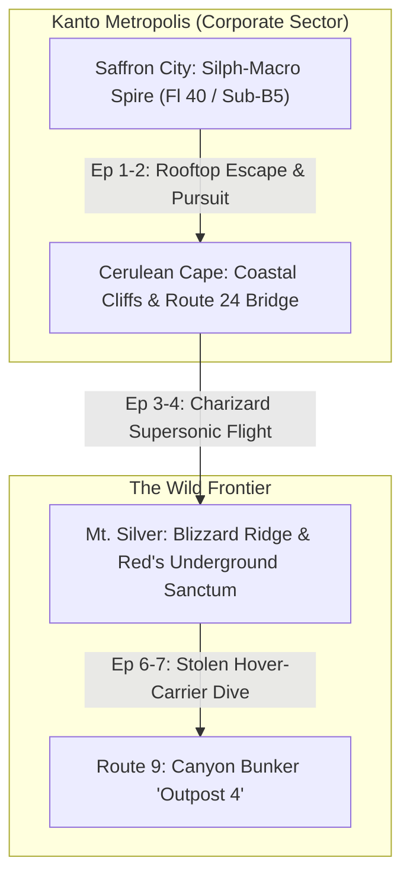

# 🗺️ PROJECT ORIGIN: THE SHATTERED CROWN
## Geographical Architecture & Tactical Location Atlas

This atlas defines the structural blueprints, ambient lighting, soundscapes, and tactical layouts for every setting appearing in Episodes 1–10.

---

---

### 1. Saffron City: Silph-Macro Spire (Episodes 1–2)
- **Coordinates & Position:** Heart of Saffron City, towering 450 meters above the metropolis.
- **Atmospheric Palette:** Dystopian corporate luxury — polished obsidian marble, brushed gunmetal steel, floor-to-ceiling smart glass, rain-streaked neon city lights reflecting off surfaces.
- **Architectural Zones:**
  - **Floor 40 Executive Penthouse:** Circular boardroom, central floating holographic dais, panoramic view of the Saffron skyline. Features bulletproof reinforced smart-glass that tints during lockdown.
  - **Exterior Scaffolding & Rooftop Labyrinth:** Wet gravel, HVAC vents, heavy commercial neon billboards, lightning rods.
- **Tactical Hazards:** Autonomous sniper drones, electrified perimeter railings, high-altitude drops.
- **Audio Soundscape:** Low-frequency air filtration hum, muffled thunder, rain pelting glass, sudden emergency sirens (Klaxon 120 dB).

---

### 2. Cerulean Cape & Sea Bluffs (Episodes 2–3)
- **Coordinates & Position:** Northern coast of Kanto, overlooking the storm-tossed Seafoam passage.
- **Atmospheric Palette:** Cold stormfront — churning dark navy waves, slick wet coastal granite, whipping sea spray, flashing red laser designators piercing sea fog.
- **Architectural Zones:**
  - **The Decommissioned Lighthouse Ridge:** Rusted steel catwalks, granite boulders, crumbling sea walls.
  - **Route 24 Narrow Bridge:** 8-meter wide concrete span crossing over jagged sea rocks.
- **Tactical Hazards:** Zero cover against aerial strafing, slick rocks reducing ground traction, high winds dampening projectile accuracy.
- **Audio Soundscape:** Crashing ocean breakers, gale-force wind howling through metal struts, sizzling rain on superheated Charizard flames.

---

### 3. Mt. Silver: The Hidden Sanctum (Episodes 4–6)
- **Coordinates & Position:** Peak altitude 3,200 meters along the Johto-Kanto border. Perpetual Category 4 blizzard.
- **Atmospheric Palette:** Harsh survivalist contrast — blinding white glacial snow outside vs. deep ember-orange firelight inside the subterranean sanctum.
- **Architectural Zones:**
  - **The Blizzard Approach:** Narrow mountain trail with sheer 1,000-foot drop-offs, zero civilian visibility.
  - **The Fortified Cavern Cabin:** Carved directly into living volcanic basalt rock. Reinforced blast door made from scrapped shipping containers. Heavy stone hearth burning dried Ironwood logs.
  - **The Subterranean Sparring Ring:** A naturally circular underground cavern with ancient stone pillars and a deep subterranean hot spring providing geothermal warmth.
- **Tactical Hazards:** Extreme hypothermia ($-15^\circ\text{C}$ to $-25^\circ\text{C}$), thin atmosphere reducing oxygen for non-acclimated trainers.
- **Audio Soundscape:** Relentless blizzard roar, crackling wood fire, deep hollow resonance of stone footsteps.

---

### 4. Route 9: Outpost 4 (Episodes 7–10)
- **Coordinates & Position:** Concealed within a dry rocky canyon between Cerulean City and the Rock Tunnel.
- **Atmospheric Palette:** Brutalist military industrial — raw poured concrete, rusted rebar, harsh overhead fluorescent tubes alternating with pulsing violet warning beacons.
- **Architectural Zones:**
  - **The Canyon Approach:** Dry ravine flanked by 40-foot cliffs, triple electrified razor-wire fences, motion-sensing automated Vulcan turrets.
  - **Sector Zero (Containment & Biopsy):** Deep subterranean basement with concrete drainage trenches, rows of shattered cylindrical cryo-stasis tubes, hydraulic surgical restraint rigs.
- **Tactical Hazards:** Enclosed narrow corridors (amplifies sound-based moves like *Hyper Voice*), volatile chemical pipelines that ignite upon fire move exposure.
- **Audio Soundscape:** Fluorescent tube buzzing, dripping coolant, metallic groaning of hydraulic clamps, feral predatory roars echoing through air ducts.
